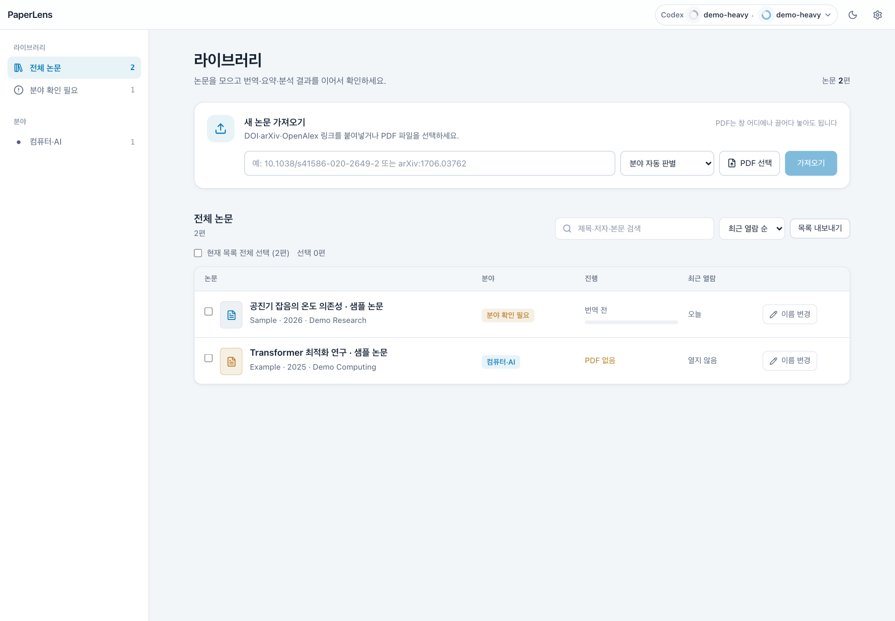
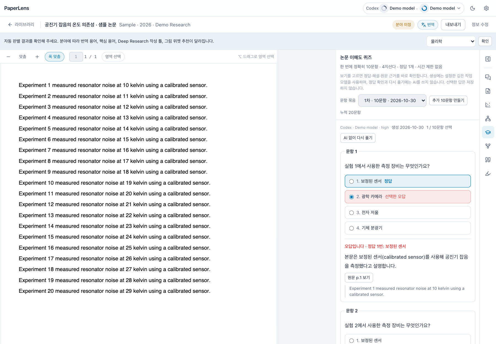

<p align="center">
  
</p>

# PaperLens

**PDF 논문을 원문 근거와 함께 읽고, 한국어로 이해하고, 내 자료로 정리하는 macOS·Windows 앱.**

[](https://github.com/Ixon27/PaperLens/releases/latest) [](https://github.com/Ixon27/PaperLens/actions/workflows/release.yml) [](LICENSE)

**[설치 파일 다운로드](https://github.com/Ixon27/PaperLens/releases/latest)** · [처음 시작하기](#처음-시작하기) · [문제 해결](#문제-해결) · [버그·기능 제안](https://github.com/Ixon27/PaperLens/issues)

PDF·메모·분석 결과는 내 컴퓨터에 보관하고, AI 기능은 **본인의 Claude 또는 Codex 계정**으로 실행한다. 설치한 앱은 아이콘으로 열며, 평소에 브라우저나 터미널을 열어 둘 필요가 없다. AI 사용 시 논문 텍스트·이미지가 해당 제공자에게 전송되고, Google Drive 동기화는 선택 사항이다.

> 이 저장소는 [Ixon27/PaperLens](https://github.com/Ixon27/PaperLens)다. 같은 이름의 [vanthree31/PaperLens](https://github.com/vanthree31/PaperLens)와는 별개의 프로젝트다. 설치 파일과 이슈를 찾을 때 저장소 소유자를 확인해 주세요.

## 목차

- [처음 시작하기](#처음-시작하기) · [주요 기능](#주요-기능) · [화면 미리보기](#화면-미리보기)
- [다운로드 · 설치](#다운로드--설치) · [AI 연결](#ai-연결--각자의-계정-사용)
- [개인정보 · 비용 · 한계](#개인정보--비용--한계)
- [저장 위치 · Obsidian](#저장-위치--obsidian) · [Google Drive 동기화](#기기-간-동기화--google-drive)
- [자세한 사용법](#쓰는-법) · [문제 해결](#문제-해결)
- [소스에서 실행 · 빌드](#소스에서-실행--빌드) · [최신 변경 사항](#057-변경-사항) · [변경 이력](#변경-이력) · [라이선스](#라이선스)

## 처음 시작하기

1. **앱 설치** — [최신 Release](https://github.com/Ixon27/PaperLens/releases/latest)의 **Assets**에서 내 OS·CPU에 맞는 설치 파일을 받는다. GitHub의 초록색 **Code** 버튼은 소스를 받는 메뉴이며 앱 설치 메뉴가 아니다.
2. **저장 위치와 AI 확인** — 첫 실행 안내에서 데이터 폴더를 확인한다. 번역·분석을 쓰려면 Claude 또는 Codex의 **브라우저 계정 연결**을 진행한다. 앱 다운로드에 AI 구독은 포함되지 않는다.
3. **논문 가져오기** — DOI·arXiv·OpenAlex 링크를 붙여넣거나, 직접 가진 PDF를 창에 끌어 놓는다. 유료 논문의 접근 권한을 우회하지 않는다.
4. **분야 확인 후 읽기** — 자동 판별 결과를 확인하거나 분야를 직접 고른다. 분야를 확인하면 저장된 요약·핵심 용어가 없는 논문에 자동 생성을 시작하며 **본인 AI 사용량이 든다**. 원문·번역을 나란히 보고, 궁금한 문장이나 그림을 선택한다.
5. **이해하고 정리하기** — 원문 근거를 누르며 토론·Deep Research·퀴즈를 이용한다. 메모를 남기고 필요한 결과를 Obsidian으로, 논문 목록을 Excel·Markdown으로 내보낸다.

PDF 읽기·하이라이트·메모·목록 내보내기는 AI 없이도 가능하다. AI 기능과 외부 논문 검색에는 인터넷과 각 서비스의 이용 권한이 필요하다.

## 주요 기능

| 작업 | 제공하는 기능 |
|---|---|
| **모으고 찾기** | DOI·arXiv·OpenAlex·PDF 가져오기, 공개 PDF 검색·재시도, 분야별 라이브러리, 검색·정렬·이름 변경 |
| **원문 읽기** | PDF·한국어 번역 병렬 보기, 문장 호버 연결·스크롤 연동, 선택 번역·설명·질문, 그림 영역 설명 |
| **내용 이해** | 핵심 용어 사전·3줄 요약·요약·토론, 섹션·그림·표 설명 카드, 원문 페이지·인용 구절로 이동 |
| **깊이 분석** | 14개 분야별 Deep Research, 선택형 연구 Gap·비평·예상 질문, 마인드맵, 연구 계보 |
| **그림과 수식 탐색** | 히스토그램·필드/등고선·ROC/PR 등 인터랙티브 위젯, 다중 곡선·로그축 수식 시뮬레이터, 전체 화면 |
| **이해 점검** | 깊은 작업 AI로 4지선다 10문항 생성·추가. 보기를 고르면 즉시 정답·해설·원문 근거 표시 |
| **연결된 연구 찾기** | 본문 인용 카드, OpenAlex 관련·피인용·같은 주제의 최신 논문 |
| **기록하고 이동** | 색상 하이라이트·메모, Obsidian 노트 내보내기, 라이브러리 Excel(`.xlsx`)·Markdown(`.md`) 목록 내보내기, 선택형 Google Drive 동기화 |

14개 분야는 생명과학, 의학·약학·보건, 농림·식품·수의, 화학, 물리학, 천문·우주, 지구·환경·해양, 수학·통계, 컴퓨터·AI, 전기·전자, 기계·항공·로봇, 재료·화학공학·에너지, 토목·건축·도시, 기타·학제간이다. 분야에 맞춰 번역 용어와 분석 틀을 바꾸며, 모든 분야에서 AI 결과의 정확성을 보장한다는 뜻은 아니다.

## 화면 미리보기

**샘플 논문·문항으로 촬영한 실제 앱 화면 (사용자 자료 아님).** 화면의 `Demo model`은 테스트용 AI 응답을 표시하며, 실제 제공자가 생성한 학술 분석 결과를 뜻하지 않는다.

| 라이브러리 | 퀴즈 — 선택 직후 정답·해설 표시 |
|---|---|
| [](assets/screenshots/library.png) | [](assets/screenshots/quiz.png) |

이미지를 누르면 크게 볼 수 있다.

## 다운로드 · 설치

**[최신 설치 파일 다운로드 →](https://github.com/Ixon27/PaperLens/releases/latest)**

설치 파일은 **GitHub Releases**에서 제공한다. Linux는 지원하지 않으며, Homebrew·WinGet·npm에 PaperLens 설치 패키지를 배포하지 않는다. 아래 소스 실행 명령은 개발자용 별도 경로다.

| 환경 | 요구 사항 | Release의 Assets에서 받을 파일 |
|---|---|---|
| macOS · Apple Silicon | macOS 13 이상, M 시리즈 | `PaperLens-<버전>-arm64.dmg` |
| macOS · Intel | macOS 13 이상, Intel CPU | `PaperLens-<버전>-x64.dmg` |
| Windows | Windows 10·11, 64비트 x64 | `PaperLens-<버전>-windows-x64-setup.exe` |

`<버전>`은 내려받는 Release의 버전이다. macOS ZIP도 제공하지만, 처음 설치할 때는 DMG를 권장한다. **Source code (zip/tar.gz)**는 실행 가능한 앱이 아니다.

### macOS

macOS 13 이상이 필요하다.

1. 내 Mac에 맞는 DMG를 연다. CPU 종류는 Apple 메뉴 → 이 Mac에 관하여에서 확인한다.
2. **PaperLens**를 **Applications**로 끌어 놓는다. DMG 안에서 계속 실행하지 않는다. 이전 이름(Paper Reader)의 앱은 지워도 되며, 논문·설정은 그대로 이어진다.
3. 응용 프로그램 폴더에서 앱을 연다. Dock에 끌어 두어도 된다.
4. 첫 실행 안내에서 저장 위치와 AI 연결 상태를 확인한다. Obsidian 볼트는 선택 사항이다.

`Cmd+Q`로 종료하면 앱 내부 백엔드와 실행 중인 AI 호출도 종료된다. 창만 닫으면 일반 맥 앱처럼 Dock에 남으며 아이콘으로 다시 연다.

현재 설치 파일은 **ad-hoc 서명만 적용했으며 Apple 공증은 받지 않았다**. 최초 실행이 차단될 수 있다. 공식 GitHub Release에서 내려받은 파일인지 확인한 뒤, 실행을 한 번 시도하고 **시스템 설정 → 개인정보 보호 및 보안 → 확인 없이 열기**에서 허용한다. 조직에서 관리하는 Mac은 이 허용이 제한될 수 있다. Gatekeeper를 전체 해제하지 않는다.

### Windows

Windows 10·11 64비트(x64)가 필요하다. 파일 이름은 `PaperLens-<버전>-windows-x64-setup.exe`다.

1. 설치 파일을 실행한다. 관리자 권한 없이 내 계정에만 설치되며 시작 메뉴와 바탕화면에 **PaperLens** 바로가기가 생긴다.
2. 코드 서명 인증서가 없어 SmartScreen의 **Windows의 PC 보호** 창이 뜰 수 있다. 공식 GitHub Release에서 받은 파일인지 확인한 뒤 **추가 정보 → 실행**을 누른다.
3. 첫 실행 안내에서 저장 위치와 AI 연결 상태를 확인한다.

Windows 11의 **Smart App Control**은 SmartScreen과 별개다. 이 앱은 현재 서명되지 않아 신뢰도를 확인하지 못하면 차단될 수 있으며, 이 경우 앱 하나만 예외로 허용하는 기능이 없다. 하루를 기다리면 해결된다는 보장도 없다. 보호 기능을 끄는 것을 권장하지 않으며, 근본적인 개선에는 신뢰할 수 있는 코드 서명 인증서가 필요하다. 자세한 내용은 [Microsoft 안내](https://support.microsoft.com/en-us/windows/security/threat-malware-protection/smart-app-control-frequently-asked-questions)를 참고한다.

창을 닫으면 앱과 내부 백엔드, 실행 중인 AI 호출이 함께 종료된다. 지우려면 **설정 → 앱 → 설치된 앱**에서 PaperLens를 제거한다. 논문·설정 폴더는 제거해도 남는다.

### 공통

Node·Homebrew·Poppler·별도 서버 설치는 **필요 없다**. 실행 환경과 PDF 엔진을 앱에 포함한다. 각 Release의 `SHA256SUMS-*.txt`로 다운로드 무결성을 확인할 수 있다.

**업데이트**: 새 버전이 나오면 앱 상단에 알림이 뜬다. **받으러 가기**로 Release 페이지에서 새 설치 파일을 받아, 앱을 종료한 뒤 Mac은 앱을 교체하고 Windows는 설치 파일을 실행한다. 논문·설정은 그대로 남는다. 앱은 하루에 한 번 GitHub에서 최신 버전 번호만 확인하며(논문 내용은 보내지 않는다), 화면이 뜬 뒤 뒤에서 확인하므로 시작이 느려지지 않는다. 설정 → 업데이트에서 끌 수 있다. 자동 설치는 제공하지 않는다.

## AI 연결 — 각자의 계정 사용

PDF 가져오기·읽기·하이라이트·메모는 AI 없이 사용할 수 있다. 번역·설명·분석·토론 등 AI 기능에는 본인 계정으로 로그인한 [Claude Code](https://code.claude.com/docs/en/setup) 또는 [Codex CLI](https://developers.openai.com/codex/cli/)가 필요하다.

**PaperLens 자체는 MIT 오픈소스이며, AI 요금·구독·사용 한도는 각 제공자가 정한다.** 연결을 확인해도 모든 모델을 쓸 수 있는 것은 아니다. 상단 모델 메뉴에서 빠른 작업·깊은 작업을 고르고, 토론 입력창에서는 대화별 모델을 따로 정할 수 있다.

<details>
<summary>계정 연결·모델 선택·작업 수준 자세히 보기</summary>

CLI 모델 목록, 작업 수준, 인증 상태를 어떻게 사용하는지에 대한 안내다.

- 앱에 공용 API 키, 개발자의 로그인, 구독 권한이 들어 있지 않다. GitHub에서 앱을 받는 것만으로 AI 구독이 제공되지 않는다.
- 첫 실행 안내 또는 **설정 → AI 연결**에서 사용할 서비스의 **브라우저 계정 연결**을 누른다. 해당 CLI가 없으면 공식 독립 실행형 설치 프로그램으로 한 번 설치한 뒤 브라우저 로그인이 자동으로 시작된다. 연결이 확인되면 그 서비스를 기본 AI로 선택한다. 설치에는 인터넷과 시스템 도구가 필요할 수 있지만 Homebrew나 시스템 Node는 필요 없다. 실패하면 화면의 공식 안내를 확인한다. 취소해도 이미 끝난 설치나 브라우저 인증은 되돌려지지 않는다.
- 로그인은 제공자의 CLI와 브라우저가 처리한다. 앱은 비밀번호나 토큰을 입력받지 않는다. Claude 브라우저가 별도 로그인 코드를 표시하면 앱에서 CLI에 전달할 수 있으며 저장하지 않는다. `연결됨`은 CLI의 로컬 인증 상태이며 구독 자격이나 모델 사용 권한을 보장하지 않는다. Claude의 브라우저 연결은 claude.ai 계정용이며 Console·클라우드 계정은 공식 안내를 따른다.
- 오른쪽 위에서 **빠른 작업**과 **깊은 작업** 모델 각각의 아이콘을 눌러 해당 모델이 지원하는 작업 수준을 순서대로 바꾼다. 아이콘에 마우스를 올리면 `Thinking effort: auto`, `low`, `medium`, `high`, `xhigh`, `max` 등의 현재 수준과 단축키가 보인다. 아이콘 위에 마우스를 둔 상태에서 `Shift+Tab`으로도 바꿀 수 있다. 입력 중이거나 키보드로 포커스를 이동하는 중에는 일반 `Shift+Tab` 동작을 유지한다. `auto`는 별도 수준을 지정하지 않고 CLI 기본값을 사용하는 뜻이다. 모델을 누르면 각 작업에 적용되는 기능을 확인할 수 있다. Claude·Codex의 **빠른 작업**과 **깊은 작업**은 모델 메뉴에서, 대화는 입력창의 모델 버튼에서 각각 설정한다. 표시·선택할 수 있는 수준은 CLI가 해당 모델에 제공한 목록을 따른다.
- 토론과 설명 카드의 입력창 아래 모델 칩에서 **이 대화의 모델**을 따로 고를 수 있다. **기본 설정 따르기**를 선택하면 응답을 만들 때의 빠른 작업 설정을 사용한다. 대화별 선택은 앱을 다시 열어도 유지된다.
- 번역·요약·Deep Research·추가 분석·인터랙티브 그림·계보·토론 답변·설명 카드·용어 설명·마인드맵·퀴즈·참고문헌에는 생성에 사용한 엔진·설정 모델·작업 수준을 표시한다. 모델 추적 전의 결과는 알려진 엔진만 표시하며, CLI 기본 모델이나 별칭은 실제로 실행된 버전을 보장하지 않는다.
- CLI 한도·로그인 오류는 앱에 표시한다. 사용량 오류를 무시하거나 자동 재시도하지 않는다. 예외는 분야 자동 판별 하나다. 아래 **학문 분야** 항목처럼, 사용량 한도·로그인 문제·미설치로 쓸 수 없는 AI만 건너뛰고 다른 AI로 한 번 판별한다.
- macOS는 Finder로 실행해도 `~/.local/bin`, `/opt/homebrew/bin`, `/usr/local/bin`에서 CLI를 찾는다. Windows는 PATH와 공식 설치 위치인 `%USERPROFILE%\.local\bin\claude.exe`, `%LOCALAPPDATA%\Programs\OpenAI\Codex\bin\codex.exe`, npm 전역 설치 위치를 찾는다. 다른 방식으로 설치한 CLI가 Node를 요구하면 그 설치 요건도 충족해야 한다. 앱의 기본 PDF 기능에는 시스템 Node가 필요 없다.

모델 목록과 모델별 작업 수준은 설치된 Claude CLI의 초기화 응답과 Codex `model/list`에서 직접 불러온다. 목록 조회는 AI 응답을 생성하지 않는다. CLI를 업데이트하거나 로그인 계정을 바꾼 뒤에는 모델 메뉴 아래의 새로고침 버튼을 누른다. 목록에 없는 기존 모델 설정은 임의로 바꾸지 않으며, 조회 실패 시 오류를 표시하고 저장된 값을 유지한다. CLI가 노출한 목록과 실제 모델 사용 권한·사용량 제한은 다를 수 있다.

</details>

## 개인정보 · 비용 · 한계

**로컬 저장은 모든 기능이 오프라인이거나 외부 전송이 없다는 뜻이 아니다.** 실행할 기능에 따라 아래 서비스를 사용한다.

| 실행하는 기능 | 저장·전송 범위 |
|---|---|
| PDF 읽기·메모·하이라이트 | PDF·DB·메모는 이 컴퓨터에 저장한다. AI를 호출하지 않는다. |
| 번역·요약·분석·토론·퀴즈 등 AI 기능 | 기능에 필요한 논문 원문 텍스트, 질문·대화 맥락 또는 선택/참조한 그림·쪽 이미지 등을 선택한 AI 제공자에게 CLI로 보낸다. AI 제공자의 데이터 처리 정책이 적용된다. |
| 논문 가져오기·공개 PDF·관련 논문 검색 | DOI·논문 제목·식별자 등을 Crossref·OpenAlex·arXiv·Unpaywall 등 해당 공개 서비스와 PDF 제공처에 요청한다. 설정한 연락처 이메일은 관련 서비스 요청에 사용한다. |
| Google Drive 동기화 — 선택 사항 | 연결한 **본인 계정**의 앱 전용 `appDataFolder`로 PDF·메모·대화·생성 결과 등 동기화 자료를 업로드한다. |
| 업데이트 확인 | 설정에서 켠 경우 하루에 한 번 GitHub의 최신 버전 번호를 확인한다. 이 확인에 논문 내용은 보내지 않는다. |

- **내 계정의 사용량**: 번역·분석·재생성에는 AI 사용량이 든다. Deep Research는 세 부분을 병렬 생성하고 추가 분석은 항목마다 요청이 늘어난다. 퀴즈는 10문항 생성·추가할 때마다 깊은 작업 모델을 사용하며, 보기 선택·정답 표시에는 AI를 쓰지 않는다. 자동 요약·핵심 용어·분야 판별도 AI 요청이다.
- **사용량 초기화 기능 없음**: 앱 재설치, 데이터 삭제, 재로그인으로 AI나 외부 API의 사용량을 초기화하지 않는다. 제한 해제 시점과 이용 권한은 제공자가 정한다. 분야 자동 판별에 한해 사용할 수 없는 엔진 대신 다른 연결된 AI를 시도할 수 있다.
- **공개 API도 무제한이 아님**: OpenAlex 요청에는 공개 API의 요청 속도·일일 사용 한도가 적용되며, 네트워크·API 상태·정책에 따라 검색이나 계보가 제한될 수 있다. 현재 앱은 공개 API를 호출하며 API 키 입력 설정은 제공하지 않는다. 최신 정책은 [OpenAlex 공식 인증·사용 한도 안내](https://help.openalex.org/api/authentication/)를 따른다. 연락처 이메일 설정은 API 키나 한도 해제를 대신하지 않는다.
- **AI 결과는 원문과 대조**: 해설·번역·인용·퀴즈 정답은 잘못될 수 있다. 그림에서 읽은 수치와 보간값은 원본 측정값이 아닐 수 있으며, 연구·의료·안전 판단을 대신하지 않는다.
- **지원 범위**: 텍스트 레이어가 없는 스캔 PDF의 OCR, KCI·Zotero 연동, Linux 배포는 지원하지 않는다. 회전 페이지나 복잡한 PDF 배치에서는 텍스트 추출·번역 연결이 어긋날 수 있다.

미공개·기밀 논문은 소속 기관과 제공자의 정책을 확인한 뒤 AI·동기화를 사용한다. 자세한 데이터 처리 안내는 [개인정보 처리 안내](PRIVACY.md)를 참고한다. GitHub 이슈에 개인 PDF, DB, 대화, 로그인 파일을 올리지 않는다.

## 저장 위치 · Obsidian

새 설치의 기본 위치:

| 항목 | macOS | Windows |
|---|---|---|
| 논문 DB | `~/Library/Application Support/paper-reader/paper-reader.db` | `%APPDATA%\paper-reader\paper-reader.db` |
| PDF·그림·임시 파일 | `~/Library/Application Support/paper-reader/files/` | `%APPDATA%\paper-reader\files\` |
| 앱 로그 | `~/Library/Logs/paper-reader/desktop.log` | `%APPDATA%\paper-reader\logs\desktop.log` |
| Obsidian 볼트 | 기본 지정 없음 — 설정에서 폴더 선택 | 같음 |

설정은 앱의 **설정** 버튼 또는 `Cmd+,`(Windows `Ctrl+,`)로 연다. 상단 바의 해·달 버튼이나 설정의 **화면 모드**에서 밝게·어둡게를 고르며, 고르는 즉시 적용되고 다음 실행에도 유지된다. 시스템은 OS 화면 모드를 따른다. **나에 대해**에 적은 배경은 분석과 토론의 설명 수준에만 반영되며 번역에는 쓰이지 않는다. 연락처 이메일은 선택 사항이며, 설정하면 OpenAlex/Crossref 요청의 연락처와 Unpaywall 오픈액세스 PDF 검색에 사용한다. 저장 위치의 **Finder에서 보기**(Windows **탐색기에서 보기**)로 데이터 폴더를 연다.

Obsidian을 사용할 경우 본인의 볼트를 선택한다. 노트는 `04_References/Papers/`, 그림 첨부는 `Attachments/paper-reader/`에 저장한다. 같은 이름의 노트는 확인 없이 덮어쓰지 않는다. PDF가 볼트 밖에 있으면 페이지 표기는 남지만 Obsidian 내부 PDF 링크는 만들지 않는다. PDF 폴더를 볼트 안에 두거나 기존 `MM` 연결을 사용하는 경우 원문 페이지 링크를 만든다. 추가 분석은 Deep Research 뒤에 내보내며, 인용 구절은 페이지 링크로 바뀐다. 인터랙티브 그림과 계보는 내보내지 않는다.

이전 웹 버전의 DB와 기존 파일 폴더가 있으면 해당 위치를 유지한다. 논문을 다른 위치로 자동 이동·복사하지 않는다. 새 사용자에게 개발자 개인 볼트 경로를 기본값으로 지정하지 않는다.

## 기기 간 동기화 · Google Drive

설정의 **기기 간 동기화 → Google 계정 연결**을 누르면 브라우저에서 Google 로그인과 권한 허용 화면이 열린다. 같은 Google 계정을 연결한 Mac·Windows 기기끼리 다음 자료를 이어서 쓴다.

- 논문 정보·분야·이름 변경, PDF
- 번역, 요약·분석·마인드맵·계보 등 AI 결과, 그림 위젯, 생성한 퀴즈 문항
- 하이라이트·메모·영역 캡처 이미지, 설명 카드와 대화, 용어 사전

자료는 본인 Google Drive의 PaperLens 전용 숨김 폴더(`appDataFolder`)에만 저장하며, PaperLens는 Drive의 다른 파일을 볼 수 없다. 앱이 켜져 있으면 시작 10초 뒤와 이후 5분마다 동기화하고, **지금 동기화**로 바로 실행할 수 있다. 다른 기기에서 받은 변경은 라이브러리 화면에 자동으로 반영된다. 삭제한 논문은 다른 기기에서도 PDF와 함께 지워진다.

- 두 기기에서 같은 항목을 동시에 고치면 나중에 고친 내용을 쓰고, 덮인 이전 내용은 그 기기의 DB(`sync_conflicts`)에 보관한다. 설정에 보관한 건수를 표시한다.
- 번역은 같은 PDF 문단이 있는 기기에만 적용한다. 앱 버전이 달라 문단 나누기가 다르면 버전을 맞춘 뒤 다음 동기화에서 적용한다.
- **여러 기기는 같은 앱 버전으로 맞춘다.** 0.5.7 이상의 퀴즈 형식(v2)은 0.5.6 형식(v1)의 질문을 읽어 이전하지만, **0.5.6은 v2 퀴즈를 읽을 수 없다**. 이전 버전에서는 해당 데이터를 보존한 채 오류를 표시하므로 모든 기기를 0.5.7 이상으로 업데이트한다.
- 관련 논문 캐시(7일)와 AI 서비스 로그인, Obsidian 볼트·화면 설정은 기기마다 따로 둔다.
- Google 로그인 정보는 이 기기에 OS 보안 저장소(macOS 키체인, Windows DPAPI)로 암호화해 보관한다. **연결 해제**는 이 기기의 로그인만 지우며 이 기기의 논문과 Drive에 올라간 자료는 남는다.

**Google OAuth 브랜딩 인증은 아직 진행 중이다.** 모든 계정에서 검증된 연결을 사용할 수 있다고 보장하지 않는다. Google의 경고·접근 제한이나 조직 계정 정책으로 연결이 막힐 수 있으며, 이 경우 로컬 기능을 계속 사용하고 동기화는 사용하지 않아도 된다. Google Drive를 쓰려면 PaperLens용 Google OAuth 클라이언트가 앱에 포함되어 있어야 한다. 포함되지 않은 빌드에서는 설정에 **준비 중**으로 표시되고 연결 버튼이 나타나지 않는다.

## 쓰는 법

<details>
<summary>가져오기·PDF 조작·분석·퀴즈·내보내기 상세 사용법 펼치기</summary>

- **가져오기**: DOI·arXiv·OpenAlex 링크(구형 arXiv 식별자와 arXiv DOI 포함)를 붙여넣거나 PDF를 창에 끌어다 놓는다. 가져오기 전에 분야를 직접 고르거나 기본값인 **분야 자동 판별**을 사용한다. 오픈액세스 PDF만 자동으로 받는다. 유료 논문은 직접 가진 PDF를 붙인다. 같은 DOI나 OpenAlex ID의 논문은 중복 등록하지 않으며 기존 분야를 바꾸지 않는다.
- **라이브러리**: 왼쪽 목록에서 전체 논문, 분야 확인이 필요한 논문, 분야별 논문을 골라 본다. 창이 좁으면 목록 위의 분류 선택으로 바뀐다. 표에서 분야·번역 진행·최근 열람을 확인하고, 최근 열람·최근 추가·제목 순으로 정렬한다. 정렬은 다음 실행에도 유지된다.
- **논문 이름 변경**: 라이브러리의 논문 옆 **이름 변경**에서 앱에 표시되는 제목을 바꿀 수 있다. PDF와 분석 결과는 유지되며, 원본 PDF 파일명은 바뀌지 않는다. 가져오기 중 바꾼 제목도 자동 메타데이터 조회가 끝난 뒤 유지된다.
- **논문 목록 내보내기**: 라이브러리의 **목록 내보내기**에서 전체·현재 분류/검색 결과·체크한 논문을 골라 Excel(`.xlsx`) 또는 Markdown(`.md`) 표로 다운로드한다. 현재 정렬을 유지하며 제목·저자·연도·학술지·DOI·분야·추가일·최근 열람일·PDF·번역·분석 상태를 포함한다. 최근 열람은 읽기 완료를 뜻하지 않으며, 목록 파일은 PDF와 전체 데이터의 백업이 아니다. 내보내기는 AI를 호출하지 않는다.
- **학문 분야**: 자동 판별이면 논문을 연 뒤 추천된 14개 분야 중 하나를 확인하거나 직접 고른다. 판별에는 가장 최근에 정상 응답한 AI(기록이 없으면 상단에서 선택한 AI)의 빠른 작업 모델을 먼저 쓴다. 그 AI가 사용량 한도·로그인 문제·미설치로 쓸 수 없으면 다른 AI(Claude ↔ Codex)로 자동 판별하고 그 사실을 표시한다. 시간 초과 같은 다른 오류에서는 다른 AI의 사용량을 쓰지 않는다. 두 AI 모두 쓸 수 없으면 이유를 표시하며, 직접 고르거나 나중에 논문을 다시 열면(라이브러리로 나갔다 들어오거나 앱을 다시 실행) 자동으로 다시 판별한다. 상단의 분야 버튼 또는 **정보 수정**에서 나중에 바꿀 수 있다. 분야에 맞춰 번역·용어·Deep Research·그림 추천이 달라진다. 확인 전 수동 AI 요청은 추천 분야를, 추천이 없으면 기타·학제간 지침을 쓴다. 기존 논문의 실험·오믹스 유형은 생명과학, 임상 유형은 의학·약학·보건으로 이전하며 그 밖의 논문은 확인이 필요하다.
- **PDF 선택**: 텍스트 선택 → 번역·설명·질문·색상 하이라이트·메모. 80자 이내의 용어를 선택하면 **용어**로 설명을 찾는다. `Option+드래그`(Windows `Alt+드래그`) 또는 영역 선택으로 그림·표·수식을 잘라 설명한다.
- **번역 열**: 상단 **번역**으로 PDF 오른쪽 번역 열을 켜고 끈다. 한국어 번역은 `~습니다` 체이며, 정착된 학술어는 한국어로, 학명·균주명·관용 약어 등은 원어로 유지한다. 번역 문장과 PDF 원문에 마우스를 올리면 양쪽의 대응 문장을 강조한다. **스크롤 연동**을 켜면 번역 열이 PDF의 현재 쪽을 따라간다.
- **오른쪽 사이드바**: 창 오른쪽 아이콘 막대에서 요약·토론·Deep Research·그림·마인드맵·퀴즈·계보·인용·관련·하이라이트를 고른다. 아이콘에 마우스를 올리면 이름이 보이고, 맨 위 버튼으로 사이드바를 닫고 연다. 닫으면 PDF와 번역 열이 창 너비를 모두 쓴다. 열 사이 경계를 드래그해 너비를 조절한다.
- **요약·토론**: 키워드 사전, 3줄 요약, 요약, 토론을 한 패널에 모아 요약을 보면서 질문한다. 분야를 확인하면 저장된 요약이 없는 논문에 요약을 자동 생성하며, 확인 전에도 직접 만들 수 있다. 섹션마다 접기·복사·다시 만들기가 있고, 질문창은 패널 아래에 고정된다.
- **키워드 사전**: 분야를 확인하면 AI가 핵심 용어 10~15개를 골라 칩으로 모은다. 칩에 마우스를 올리면 설명과 논문 속 의미가 보인다. PDF의 **용어** 또는 번역문 드래그 후 **용어 설명**으로 찾은 용어도 자동 저장되며, 핵심 용어를 다시 만들어도 직접 찾은 용어는 남는다. 같은 논문의 같은 용어는 저장된 설명을 즉시 다시 보여준다. 용어를 저장할 때 짝이 맞는 괄호를 보존하며, 이전에 저장된 AI 용어의 잘린 약어 괄호는 표시할 때 보정한다.
- **설명 카드**: PDF의 섹션 제목 옆과 그림·표 캡션 옆의 ✦ 표시를 누르면 AI 설명 카드가 뜬다. 섹션은 그 섹션 본문 전체로, 그림·표는 캡션·본문 언급·쪽 이미지로 설명하며, 끝의 **생각의 확장** 질문이나 직접 입력으로 이어서 묻는다. 카드 상단을 끌어 PDF 영역 안에서 옮기거나 모서리를 끌어 크기를 바꾼다. **최소화**한 뒤 다시 열면 원래 위치에 나타나며 크기는 유지된다. 설명이 저장된 표시는 강조색으로 바뀌어 다시 누르면 저장된 카드가 열린다. 삭제는 확인 후 영구 삭제한다.
- **Deep Research**: 논문의 분야별 Methods 틀로 바로 시작하며, 세 부분을 병렬 작성해 요약·Why·Abstract·Introduction·Methods·Results·Discussion·한계점·핵심 개념 심층·연구 적용 순서로 합친다. 리뷰·메타분석은 리뷰 논문 틀을 쓴다. 요약은 핵심·Gap·접근·결과 표와 문제 콜아웃으로 시작한다. 인용 칩에 마우스를 올리면 원문 구절을 보고, 누르면 PDF의 구절을 강조한다. 정확한 구절을 찾지 못하면 해당 쪽으로 이동한다. 섹션 커버리지는 인용 위치로 계산한 참고 지표이며 내용의 정확성을 보장하지 않는다.
- **추가 분석**: Deep Research 아래에서 연구 Gap 표·논문 비평·예상 질문 중 필요한 항목만 선택해 실행한다. 항목마다 깊은 작업 AI 호출이 1회 늘어나며 기존 결과를 다시 만들면 해당 결과가 바뀐다.
- **인터랙티브 그림·표**: 그림 탭에서 자동 또는 원하는 위젯 종류를 골라 만든다. 히스토그램·필드 맵·등고선·ROC/PR 곡선과 여러 식을 비교하는 로그축 수식 시뮬레이터를 포함한다. 각 위젯의 **전체 화면**으로 확대하고 **닫기** 또는 `Esc`로 돌아가며, 선택한 단계와 그래프 설정은 유지된다. 근거를 누르면 전체 화면을 닫고 PDF로 이동한다. AI가 반환한 데이터 사양을 검증한 뒤 앱이 렌더링하며 AI가 만든 코드는 실행하지 않는다. 그림에서 읽은 수치는 근사값으로 표시되고 원본 핫스팟은 실험적이므로 원문과 대조한다.
  - 선 그래프와 ROC/PR 곡선은 슬라이더나 숫자 입력으로 X값을 고르면 시리즈별 값을 표시한다. 데이터 지점 사이의 값은 현재 축에 맞춰 보간한 추정치이며, 범위 밖의 값은 추정하지 않는다. 스크린샷에서 읽어 생성된 값이라면 데이터 지점도 정확한 원본 측정값이 아닐 수 있다.
  - 막대 그래프는 범주 이름을 가로로 읽을 수 있도록 막대를 가로로 배치한다. 흐름도는 선택한 단계를 중심으로 이동하며 드래그와 스크롤로 이동·확대·축소한다. 화살표 설명은 겹치지 않도록 아래 관계 목록에 표시한다. 다른 항목이 많은 그래프는 축 이름을 회전하거나 필요하면 가로로 스크롤해 전체를 보여 준다. 로그 축은 표시 중인 값과 오차 범위가 양수일 때만 선택할 수 있다. 박스플롯의 평균은 제공된 그룹에만 표시하며 없는 평균은 추정하지 않는다. 사용할 수 없는 옵션의 이유는 그래프에 표시한다.
- **마인드맵·연구 계보**: 두 그래프 모두 **전체 화면**으로 확대하고 **닫기 (Esc)** 또는 `Esc`로 돌아갈 수 있다. 마인드맵은 양쪽 가지로 배치하며 노드를 끌어 위치를 바꾸고 저장할 수 있다. 계보는 OpenAlex의 실제 참고·피인용 관계에 맞춰 선행 연구와 후속 연구를 배치한다. 데이터가 없으면 논문에서 추출한 참고문헌을 사용한다. 논문을 선택하면 AI가 정리한 기여 설명과 원문 근거를 볼 수 있고 DOI가 있으면 라이브러리로 가져올 수 있다. 해석과 인용 관계는 원문에서 확인한다.
- **퀴즈**: PDF 본문에서 4지선다 10문항을 깊은 작업 AI로 생성한다. 보기를 고르면 **즉시 정답·해설과 원문 p.N 보기**를 표시한다. 제출 버튼·답안 임시 저장·답안 저장·제출 이력은 없으며, **생성한 질문 묶음만 저장·동기화**한다. 선택한 답은 앱을 다시 열어 이어 풀기 위한 기록으로 남기지 않는다. **추가 10문항 만들기**는 기존 질문을 전달해 중복을 줄이고 이전 질문 묶음은 유지한다. 정답·해설 표시에는 AI를 쓰지 않고 시간 제한도 없다. 문항 생성은 한 번의 AI 요청이며 형식·문항 수·중복·원문 구절 검증에 실패하면 기존 문항을 보존하고 오류를 표시한다. 정확한 질문 문자열 중복과 근거 구절의 존재는 검사하지만 의미상 중복이나 정답의 학술적 정확성은 보장하지 않으므로 원문과 대조한다.
- **스마트 인용·관련 논문**: 본문의 `[12]`, `(Smith et al., 2020)` 같은 인용을 누르면 참고문헌 카드가 열린다. 숫자 괄호 인용은 생명과학·의학·농림·기타 분야에서만 인식하며 식·그림 번호는 제외한다. 관련 논문에는 OpenAlex의 비슷한 논문·피인용 논문과 같은 주제의 최신 논문을 표시한다. 가져오기 진행 상태와 공개 PDF 검색 결과를 표시하며, 이미 저장한 논문의 PDF가 없으면 **PDF 찾기·다시 시도**로 다시 찾을 수 있다. 제목과 DOI가 명확히 다른 PDF는 제외하지만 식별 정보가 부족한 파일은 판별이 어려우므로 원문을 확인한다.
- **중단·재개**: 진행 막대의 취소로 작업을 멈춘다. 취소한 작업은 오류로 표시하지 않는다. 완료된 번역·분석은 재실행 후에도 남는다. 이어서 번역은 빠진 문단부터 처리한다. 이전 번역은 열 때 번역문을 유지한 채 PDF 좌표와 문장 연결 정보만 자동 보완한다. 원문·번역의 문장 수가 다르거나 좌표를 확정할 수 없으면 **문장 연결 없음**으로 표시하며, 문단 전체를 대신 강조하지 않는다.

</details>

## 문제 해결

| 증상 | 확인할 것 |
|---|---|
| GitHub의 Code 메뉴에서 설치가 안 됨 | **Code → Clone / Download ZIP은 소스 복사**다. 일반 사용자는 [Releases의 Assets](https://github.com/Ixon27/PaperLens/releases/latest)에서 DMG·EXE를 받는다. 터미널 실행은 아래 소스 절차를 따른다. |
| Mac에서 실행이 차단됨 | 공식 Release와 CPU 종류를 확인하고 앱을 Applications로 옮긴다. 한 번 실행 시도 후 개인정보 보호 및 보안에서 허용한다. Gatekeeper 전체를 끄지 않는다. |
| Windows에서 보안 경고·차단 | SmartScreen과 Smart App Control은 다르다. [설치 안내](#windows)를 확인한다. 조직 보안 정책을 우회하거나 보호 기능을 끄는 방법은 권장하지 않는다. |
| AI가 연결되지 않거나 모델이 없음 | 설정 → AI 연결에서 인증 상태를 확인한다. 공식 CLI를 업데이트·로그인한 뒤 모델 메뉴를 새로고침한다. `연결됨`과 특정 모델의 사용 권한은 별개다. |
| 사용량 한도·로그인 오류 | 표시된 제공자의 안내와 한도 갱신 시점을 확인한다. 재설치해도 한도는 초기화되지 않는다. 직접 모델·서비스를 바꾸면 그 계정의 사용량이 든다. |
| 요약·핵심 용어가 자동 생성되지 않음 | 논문 분야가 확인됐는지, PDF 본문이 추출됐는지, AI가 연결됐는지 확인한다. 저장된 결과는 자동으로 다시 생성하지 않는다. |
| PDF가 없거나 엉뚱한 파일 같음 | 정보 수정에서 DOI를 확인하고 **PDF 찾기·다시 시도**를 이용한다. 유료·비공개·공개본 미제공 논문은 직접 가진 PDF를 붙인다. 식별 정보가 부족한 파일은 직접 원문을 확인한다. |
| OpenAlex 검색·관련 논문·계보 실패 | 네트워크와 [공식 API 사용 한도](https://help.openalex.org/api/authentication/)를 확인한다. 새로고침을 반복하면 요청량이 늘어난다. 서비스에 자료가 없을 수도 있다. |
| Google Drive 연결 불가·준비 중 | OAuth 클라이언트 포함 여부, 브랜딩 인증 진행 상황, Google·조직 계정의 접근 제한을 확인한다. AI 연결과 Google 동기화는 별개다. |
| 번역 문장과 원문이 연결되지 않음 | 추출 위치·문장 수를 확정할 수 없으면 **문장 연결 없음**으로 표시한다. 스캔·회전·복잡한 배치는 지원 한계를 확인한다. 재번역은 AI 사용량이 든다. |

해결되지 않으면 [기존 이슈 검색](https://github.com/Ixon27/PaperLens/issues) 후 [새 이슈](https://github.com/Ixon27/PaperLens/issues/new)를 연다. **앱 버전·OS/CPU·재현 순서·오류 메시지**를 적고, 설정의 저장 위치에서 로그 경로를 확인한다. 로그·화면을 공유하기 전 논문 제목·개인 경로·이메일·대화·인증 정보를 가린다. 문제 해결을 위해 DB나 논문 폴더를 삭제할 필요는 없다.

## 소스에서 실행 · 빌드

**개발자용 경로**다. `git clone`은 소스 복사일 뿐이며 의존성 설치·빌드까지 끝내야 실행된다. GitHub CLI의 `gh repo clone Ixon27/PaperLens`도 같은 목적의 복사 명령으로, 앱 설치를 대신하지 않는다.

macOS 또는 Windows, **Node.js 24 이상**(24 LTS 또는 26 이상 권장), npm, Git과 빌드 환경이 필요하다. Electron·네이티브 의존성 다운로드를 위해 인터넷을 사용한다. 네이티브 모듈을 직접 컴파일해야 하는 환경은 해당 도구 체인(macOS Xcode Command Line Tools, Windows Visual Studio C++ Build Tools·Python 등)도 필요하다. 배포 설치 파일을 쓰면 이런 개발 도구는 필요 없다. 패키지는 해당 OS·CPU에서 빌드한다.

```bash
git clone https://github.com/Ixon27/PaperLens.git
cd PaperLens
npm ci
npm run desktop              # 전용 앱 창으로 실행
```

위 명령은 소스 폴더에서 빌드한 앱 창을 연다. macOS에서 소스 빌드를 앱으로 설치하려면 같은 폴더에서 다음을 실행한다.

```bash
npm run install:app           # 빌드 → ~/Applications/PaperLens.app 설치 + 바탕화면 바로가기
```

이 명령은 Homebrew·npm 레지스트리에서 완성 앱을 받는 명령이 아니다. 빌드된 앱을 설치한 뒤에는 원본 저장소나 시스템 Node 없이 실행할 수 있다. Windows 설치 파일을 직접 만들려면 아래 `npm run dist:win`을 사용한다.

<details>
<summary>개발 명령·환경 변수·패키징·구현 주의사항</summary>

```bash
npm run dev                  # 웹 개발: localhost:5173, API: 127.0.0.1:4317
npm run build && npm start   # 웹 프로덕션 모드 (POSIX 셸)
npm run typecheck
npm test
npm run pack:mac             # macOS: 현재 CPU용 .app → release/
npm run dist:mac             # macOS: 현재 CPU용 DMG + ZIP → release/
npm run pack:win             # Windows: 설치 없이 실행하는 폴더 → release/win-unpacked/
npm run dist:win             # Windows: x64 설치 파일 → release/
```

`npm start`는 `NODE_ENV=production` POSIX 셸 문법을 쓴다. Windows 기본 명령 프롬프트·PowerShell에서 웹 프로덕션 모드를 실행하려면 환경 변수를 해당 셸 문법으로 설정하고 `npx tsx src/server/index.ts`를 실행한다. 일반 앱 실행(`npm run desktop`)과는 별개다.

macOS 설치 스크립트는 실행 중인 앱·AI 작업을 강제 종료하지 않는다. 재설치 전 `Cmd+Q`로 종료한다. 배포 앱은 원본 저장소가 없어도 실행된다.

### 환경 변수

필요한 경우에만 실행 전에 지정한다. 기존 DB에 저장된 설정이 있으면 볼트·연락처는 저장된 설정을 따른다.

| 변수 | 기본값 / 용도 |
|---|---|
| `PAPER_READER_USER_DATA` | 앱 사용자 데이터 폴더. 기본 macOS `~/Library/Application Support/paper-reader`, Windows `%APPDATA%\paper-reader` |
| `PAPER_READER_DB_DIR` | DB 폴더를 별도로 지정 |
| `PAPER_READER_FILES` | PDF·그림 폴더. 기본 DB 폴더 아래 `files/` |
| `PAPER_READER_VAULT` | 초기 Obsidian 볼트. 빈 문자열이면 지정하지 않음 |
| `PAPER_READER_EMAIL` | 초기 연락처 이메일. 기본 없음 |
| `PAPERLENS_GOOGLE_CLIENT_ID` | Google 데스크톱 OAuth 클라이언트 ID. 앱에 포함된 값보다 우선 |
| `PAPERLENS_GOOGLE_CLIENT_SECRET` | 같은 클라이언트의 secret. Google 데스크톱 클라이언트는 공개 값으로 취급한다 |

웹 백엔드는 `127.0.0.1`에만 연결한다. 데스크톱 앱은 임의 포트와 매 실행마다 새 인증 토큰을 사용한다. 렌더러는 sandbox/context isolation을 적용하고 Node 접근을 허용하지 않는다. 외부 링크는 별도 브라우저에서 연다.

### Release

버전을 갱신하고 `v<버전>` 태그를 push하면 [release workflow](.github/workflows/release.yml)가 macOS Apple Silicon·Intel과 Windows x64 네이티브 러너에서 각각 빌드하고 DMG·ZIP·설치 파일(exe)·체크섬을 GitHub Release에 게시한다. 게시 전에 포함된 SQLite/FTS·PDF 런타임과 새 사용자 상태의 실제 앱 창에서 PDF 가져오기·뷰어 렌더링·정상 종료를 OS마다 확인한다. 동일한 태그로 수동 실행도 가능하다. 현재는 Apple Developer·Windows 코드 서명 인증서 없이 배포하는 설정이다.

### 구현 주의사항

- PDF 텍스트·좌표 추출과 화면 worker는 모두 로컬 `pdfjs-dist@4.10.38`을 사용한다. 외부 PDF 프로그램이나 CDN worker를 사용하지 않는다.
- `react-pdf-highlighter-extended@8.1.0`의 페이지별 그룹 함수는 다중 줄 하이라이트를 중복 렌더링한다. Vite alias로 `src/web/pdf/group-highlights-by-page.ts`를 적용하며 라이브러리 자체를 prebundle에서 제외한다. 버전을 올릴 때 이 처리를 확인한다.
- `prompts/*.md`는 소스 실행에서 다음 AI 호출부터 반영된다. 배포 앱은 빌드 당시 프롬프트를 포함한다. 독자 배경 설명은 앱 설정에서, 모델·작업 수준은 오른쪽 위 모델 버튼에서 바꾼다.

</details>

## 0.5.7 변경 사항

- 퀴즈를 보기 선택 즉시 정답·해설·원문 근거를 확인하는 방식으로 바꿨다. 답안 임시 저장·제출·풀이 이력은 제거하고 생성한 질문 묶음만 유지한다. 기존 퀴즈는 질문을 보존한 채 저장된 답안·제출 기록만 제거한다.
- 모델 선택 메뉴의 깊은 작업 목록에 퀴즈 생성을 표시한다.
- README를 설치·AI 연결·기능 안내와 소스 실행 경로로 나누고 외부 전송·사용량·보안 제한을 명확히 했다.
- 동기화하는 모든 기기를 0.5.7 이상으로 맞춰야 퀴즈를 열 수 있다.

## 변경 이력

역대 배포 당시의 기록이다. 현재 동작은 위 사용법과 최신 변경 사항을 참고한다.

<details>
<summary>0.5.6 및 이전 릴리스 변경 사항 펼치기</summary>

## 0.5.6 변경 사항

- 논문별 4지선다 퀴즈를 10문항씩 생성하고 추가할 수 있다. 임시 답안·채점 결과·제출 기록을 보관하며 원문 근거로 이동한다. 같은 문제 다시 풀기와 채점은 AI를 호출하지 않는다.
- 라이브러리 전체·현재 분류/검색 결과·선택한 논문을 Excel(`.xlsx`) 또는 Markdown(`.md`) 표로 내보낸다. 현재 정렬과 한글 내용을 유지하며 AI를 호출하지 않는다.
- PDF를 여는 도중 원문 근거를 누르면 페이지가 준비된 뒤 이동하도록 개선했다.

## 0.5.5 변경 사항

- 선택적으로 본인 Google Drive의 앱 전용 폴더를 통해 논문과 저장된 결과를 기기 간 동기화한다. Google 브랜딩 인증은 진행 중이다.
- 라이브러리의 분야별 탐색·정렬·논문 이름 변경을 추가하고 화면을 정리했다.
- 분야 자동 판별에서 AI 로그인이나 사용량 문제로 사용할 수 없는 경우 다른 연결된 엔진을 시도한다.

## 0.5.4 변경 사항

- 빠른 작업과 깊은 작업의 모델·작업 수준을 각각 표시하고, 모델 메뉴에서 기능별 사용 모델을 확인할 수 있다.
- 마인드맵과 연구 계보의 배치를 개선하고 전체 화면을 추가했다. 설명 카드는 끌어서 옮길 수 있으며 닫고 다시 열면 원래 위치로 돌아간다.
- 인용·관련 논문에서 공개 PDF를 찾고 기존 논문의 PDF 검색을 재시도할 수 있다. 명확히 다른 논문의 PDF는 제외한다. 인터랙티브 전체 화면의 닫기 버튼을 간결하게 바꾸고 위젯 종류 배지는 제거했다.
- Windows 11 Smart App Control의 서명되지 않은 설치 파일 차단 가능성을 안내한다.

## 0.5.3 변경 사항

- 처음 실행할 때 Claude 또는 Codex의 **브라우저 계정 연결** 한 번으로 필요한 공식 CLI 설치부터 브라우저 로그인까지 이어진다.
- 계정 인증을 실제로 확인한 뒤 연결한 서비스를 기본 AI로 선택하고, 설정 창을 닫아도 진행 중인 연결 결과를 반영한다.
- Windows 새 사용자 환경에서 두 공식 CLI 설치와 로그인 시작을 배포 검증에 추가했다.

## 0.5.2 변경 사항

- Mac 전체 화면의 닫기 버튼을 창 드래그 영역 아래에 배치하고 클릭 영역을 넓혔다. 버튼에 `닫기 (Esc)`를 표시한다.
- 막대 그래프를 가로로 배치해 범주 이름을 돌리지 않고 읽을 수 있다. 계열 선택·정렬·오차 막대·로그 축은 유지한다.
- 흐름도 위의 확대·축소·방향 버튼 묶음을 제거하고 드래그와 스크롤 조작을 유지한다.

## 0.5.1 변경 사항

- 인터랙티브 위젯에 전체 화면을 추가했다. 닫거나 `Esc`를 누르면 선택한 단계와 그래프 설정을 유지한 채 돌아간다.
- 흐름도의 겹치던 연결 설명을 관계 목록으로 옮기고, 선택한 단계 중심 이동과 확대·축소·전체 보기를 제공한다.
- 선 그래프와 ROC/PR 곡선에서 슬라이더 또는 숫자로 X값을 바꾸며 데이터 지점과 보간값을 비교한다. 데이터 범위 밖은 추정하지 않는다.
- 긴 그래프 라벨, 네트워크·벤 다이어그램의 가독성을 개선하고 전체 화면에서 원문 근거를 누르면 PDF로 돌아가도록 했다.

## 0.5.0 변경 사항

- 생명과학부터 수학·물리·컴퓨터·공학까지 14개 학문 분야를 지원한다. 가져올 때 분야를 지정하거나 AI 추천을 확인하며, 분야별 번역·용어·Deep Research 작성 틀을 적용한다.
- 알고리즘·코드·한글 캡션과 다양한 절·참고문헌 구조를 인식하고, 이공계 논문의 인용과 수식·화학식 표시를 개선했다.
- 구형 arXiv 식별자와 arXiv DOI, OpenAlex 전용 DOI를 가져올 수 있고, 같은 주제의 최신 논문을 OpenAlex에서 찾는다.
- 히스토그램, 필드·등고선 맵, ROC/PR 곡선, 다중 곡선·로그축 수식 시뮬레이터를 추가했다.
- 분야 확인 전 자동 요약과 핵심 용어 생성을 기다리며, 기존 논문의 연구 유형을 가능한 분야로 이전한다.

## 0.4.5 변경 사항

- 키워드 사전에서 용어 끝의 닫는 괄호가 사라지는 문제를 고쳤다. 기존 AI 키워드의 잘린 약어 괄호도 표시할 때 복원하며 저장된 용어는 그대로 유지한다.
- 새 핵심 용어를 만들 때 빈 괄호나 짝이 맞지 않는 괄호, 기호만 있는 항목을 제외한다.
- **심층 분석**의 표시 이름을 **Deep Research**로 바꿨다. 저장된 분석 결과는 유지된다.

## 0.4.4 변경 사항

- 항목이 많거나 이름이 긴 그래프의 축 라벨이 겹치거나 잘리지 않도록 배치하고, 필요할 때 가로 스크롤을 제공한다.
- 로그 축은 현재 보이는 데이터와 오차 범위를 기준으로 선택 가능 여부를 판단하고 불가능한 이유를 안내한다.
- 박스플롯에 제공된 평균이 없거나 일부만 있을 때 이를 안내하고 실제로 제공된 평균만 표시한다.

## 0.4.3 변경 사항

- 모델 옆 작업 수준을 간결한 아이콘으로 표시하고, 마우스를 올리면 현재 수준과 `Shift+Tab` 안내를 보여 준다.
- `auto`는 점선, `low`·`medium`은 회색 진행 링, `high`는 파란색 링, `xhigh`는 금색 링, `max`는 불꽃으로 구분한다. 클릭하거나 아이콘 위에서 `Shift+Tab`을 눌러 지원되는 수준을 순서대로 바꾼다.
- 빠른 작업·깊은 작업·대화별 선택을 각각 유지하며, 텍스트 입력과 키보드 포커스 탐색은 단축키가 가로채지 않는다. 모델이 지원하지 않는 수준은 추가하지 않는다.

## 0.4.2 변경 사항

- 그림·계보를 불러오지 못할 때 오류와 다시 불러오기 버튼을 표시하고, 인식된 그림·표 캡션이 없을 때 이유를 안내한다.
- Obsidian으로 내보낸 표 안의 PDF 인용 링크가 표 열을 나누지 않도록 수정했다.

## 0.4.1 변경 사항

- 첫 실행 안내와 설정의 **AI 연결**에서 Claude Code·Codex를 설치하고 브라우저 로그인을 시작할 수 있다. 계정과 사용 권한은 각 제공자가 관리한다.
- 모델 버튼의 링과 영문 작업 수준을 누르면 해당 모델이 지원하는 수준을 순서대로 바꾼다. 빠른 작업·깊은 작업과 대화별 수준을 따로 정할 수 있다.
- 설치하거나 로그인한 뒤 모델 목록과 사용 가능한 AI 엔진을 다시 확인한다.

## 0.4.0 변경 사항

- 심층 분석 요약을 핵심·Gap·접근·결과 표와 문제 콜아웃으로 정리하고 핵심 결과 수치를 강조한다.
- 인용 구절을 미리 보고 PDF 원문에서 강조할 수 있으며, 인용 위치를 바탕으로 섹션 커버리지를 표시한다.
- 연구 Gap 표·논문 비평·예상 질문을 필요한 항목만 선택해 추가 분석할 수 있다.
- 그림·표를 19종의 인터랙티브 위젯으로 볼 수 있다. 이미지에서 읽은 값은 근사값으로 표시한다.
- OpenAlex 참고·피인용 데이터와 논문 참고문헌을 이용해 연구 계보를 만들고 원문 근거를 확인할 수 있다.
- 추가 분석을 Obsidian 노트에 포함하며, 인용 구절은 페이지 링크로 바꾼다.

업데이트해도 기존에 저장한 분석 결과는 그대로 유지된다. 새 요약 형식과 인용 구절은 **Deep Research → 다시 분석**으로 새로 생성해야 한다. 추가 분석은 Deep Research 아래에서 선택해 실행하고, 그림·계보는 논문을 연 뒤 오른쪽 사이드바의 **그림**·**계보**에서 각각 만들어야 한다. 생성에는 선택한 AI 계정의 사용량이 든다.

## 0.3.2 변경 사항

- Windows에서 최신 npm Claude Code의 네이티브 실행 파일(`bin/claude.exe`)을 인식하지 못하던 문제를 수정했다. 기존 Node 스크립트 방식도 유지한다.
- Windows 줄바꿈(CRLF)으로 저장된 프롬프트를 읽지 못해 요약·키워드 생성 시 `Cannot read properties of undefined (reading 'replace')`가 발생하던 문제를 수정했다.
- Windows 배포 검증에 실제 npm Claude Code 설치 후 `--version` 실행 확인을 추가했다. 로그인 후 AI 응답 생성까지 검증하는 것은 아니다.

## 0.3.1 변경 사항

- 새 버전 알림을 추가했다. 하루 한 번 GitHub 최신 릴리스 번호만 확인하고, 닫은 버전은 다시 알리지 않는다. 설정에서 끌 수 있다.

## 0.3.0 변경 사항

- **Windows(x64) 앱**을 추가했다. 관리자 권한 없이 설치되며, 데이터는 `%APPDATA%\paper-reader`에 저장한다. npm으로 설치한 Claude·Codex CLI도 명령 창을 거치지 않고 실행한다.
- 화면을 정리된 새 디자인으로 바꿨다. 설정의 **화면 모드**에서 시스템·밝게·어둡게(Tern 스타일)를 고르고, 제목 표시줄을 앱 상단 바와 합쳤다.
- 엔진 전환 버튼과 설정의 모델 항목을 오른쪽 위 모델 버튼 하나로 합쳤다. Claude·Codex 모두 빠른 작업·깊은 작업의 모델과 작업 수준(effort)을 따로 고른다. 기존 Codex 모델 설정은 두 작업에 그대로 옮겨진다.
- 설정 화면을 항목별로 다시 구성하고 저장 위치를 Finder에서 열 수 있게 했다.
- PDF를 끌어다 놓을 때의 물결 효과, 분할 화면·탭·대화상자 전환 효과를 추가했다. macOS의 동작 줄이기 설정을 따른다.
- 번역 문단 나누기를 고쳤다. 머리말·꼬리말·쪽 번호·제목과 저자·여백 정보·표 칸·수식·연구비/기여/이해충돌 같은 부속 정보는 번역에서 빠지고, 본문은 문장 단위로 잘리지 않고 문단 단위로 묶인다. 쪽이나 단을 넘어가는 문단은 하나로 이어진다. 번역하지 않은 기존 논문은 열 때 새 기준으로 다시 나누고, 번역이 있는 논문은 **다시 번역**할 때 다시 나눈다.
- PDF 오른쪽 번역 열을 독립적으로 켜고 끄도록 바꿨다. 번역과 원문은 양방향 문장 호버로 연결하며, 용어 설명은 키워드 사전에 자동 저장한다.
- 번역을 문장별로 정렬하고 한국어 학술어·원어 유지 기준과 `~습니다` 문체를 적용했다.
- 분석 앞에 자동 요약을 추가했다. 심층 분석 세 부분은 병렬 생성한 뒤 읽기 순서로 합치며, 섹션별 접기·복사·이동을 제공한다. 여러 줄 수식 뒤의 본문까지 수식으로 처리되던 렌더링 오류를 고쳤다.
- 대화별 모델 선택과 AI 결과별 생성 모델 표시를 추가했다. 기존 결과의 알려지지 않은 모델 정보는 추정해 채우지 않는다.
- Claude 호출에서 사용하지 않는 MCP 서버·슬래시 명령 로딩을 끄고 참고문헌 추출을 병렬화했다. 전체 CLI 동시 실행은 3개, 번역 페이지 처리는 2개로 제한한다.
- 기존 번역이 있는 논문에서 문장 대신 문단 전체가 강조되던 호환 오류를 고쳤다. 재번역 없이 저장된 번역문·생성 모델을 유지하며 문장 연결과 PDF 글자 좌표를 보완한다. `sp. (S1)`, 숫자·시간·온도 단위와 한국어에 붙은 `pH` 같은 용어의 문장 경계도 구분한다.
- 오른쪽 탭을 아이콘 사이드바로 바꿨다. 좁은 창에서도 이름이 잘리지 않고, 사이드바를 닫으면 PDF·번역이 창 너비를 모두 쓴다. 패널은 최소 너비를 지키며 번역 열을 가리지 않는다.
- 키워드 사전(AI가 고른 핵심 용어와 직접 찾은 용어), 3줄 요약, 요약, 토론(이전 채팅)을 **요약·토론** 패널 하나로 합쳤다. 단어장 열은 없앴다.
- PDF 섹션 제목·그림·표 캡션에서 여는 AI 설명 카드를 추가했다. 크기 조절·최소화·삭제와 이어 묻기를 지원하며, 저장된 설명은 다시 생성하지 않고 연다.
- 번역 도구 막대를 한 줄로 정리하고 **원문 함께 보기**를 뺐다. 사용자가 취소한 작업은 빨간 오류로 표시하지 않는다.
- 앱 이름을 **PaperLens**로 바꾸고 아이콘을 새로 만들었다. 데이터 폴더(`paper-reader`)와 앱 식별자는 그대로라 기존 논문·설정이 이어진다.
- 상단 바에 밝은/어두운 화면 전환 버튼을 추가했다. 번역 열의 **동기 스크롤**을 **스크롤 연동**으로, 논문 화면의 **Obsidian으로 내보내기**를 **내보내기**로 바꿨다.
- 심층 분석의 구성을 요약·Why·Abstract·Introduction·Methods·Results·Discussion·한계점·핵심 개념 심층·연구 적용으로 정리하고 읽기 로드맵·공부 단어장을 뺐다. 이미 만든 분석도 화면과 내보내기에서 같은 이름·순서로 보인다.

## 0.2.1 변경 사항

모델 직접 입력을 CLI 모델 목록 기반 드롭다운으로 교체했다. Claude 빠른/깊은 모델과 Codex 모델을 선택·저장할 수 있으며, 모델 목록을 새로고침해도 편집 중인 설정을 유지한다. 모델 목록 조회 중 앱을 종료하면 조회용 CLI도 함께 종료한다.

## 0.2.0 변경 사항

브라우저를 여는 AppleScript 실행기를 전용 Electron 앱으로 교체했다. Node 런타임과 PDF 추출을 포함하고, 사용자별 저장소·선택형 Obsidian 연결·첫 실행 안내·네이티브 메뉴·DMG/ZIP 배포를 추가했다. 기존 로컬 DB·논문·AI 설정은 유지한다.

</details>

## 라이선스

[MIT](LICENSE). AI 제공자와 외부 데이터 서비스의 계정·이용 조건은 별도다.
